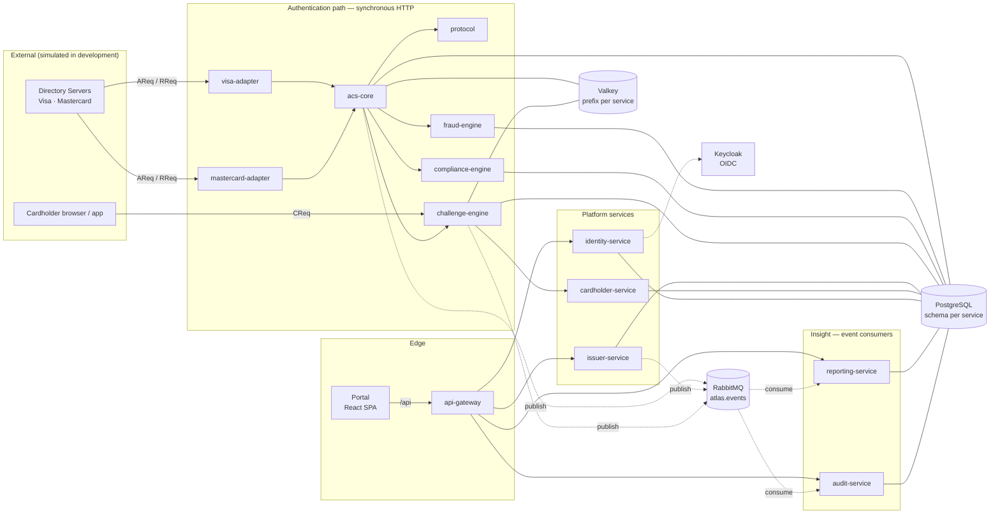
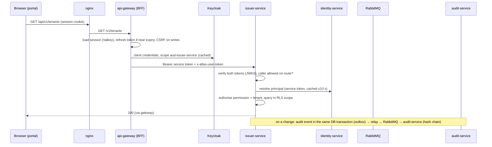

# Architecture

> Stage 0 implemented the structure below as running service skeletons. Stage 1A implements the
> platform services — api-gateway, identity-service, issuer-service and audit-service — and the
> security, messaging and observability foundations they share. The authentication-path services are
> still skeletons (Stage 1B onwards).

## Overview

ATLAS is a set of independently deployable TypeScript/Fastify services, a React portal, and shared
libraries, running on PostgreSQL, Valkey and RabbitMQ. Services communicate synchronously over HTTP on
the latency-critical authentication path, and asynchronously over RabbitMQ for everything that can be
eventually consistent (audit, reporting, notifications).

Solid arrows are synchronous calls; dotted arrows are asynchronous events. Implemented in Stage 1A:
portal → gateway → identity/issuer/audit, identity ↔ issuer, issuer/audit → identity, the services' →
Keycloak (tokens, keys, user administration), and identity/issuer/gateway → RabbitMQ → audit.

## Stage 1A request flow

Key decisions: backend-for-frontend sessions (ADR-024), database roles (ADR-025), identity-service as
system of record for authorisation (ADR-026), service tokens per callee (ADR-027), audit pipeline
(ADR-028), trace backend (ADR-029), MFA for platform permissions (ADR-030).

## Services and responsibilities

| Service              | Domain         | Responsibility (target)                                                                       | Owns                                                          |
| -------------------- | -------------- | --------------------------------------------------------------------------------------------- | ------------------------------------------------------------- |
| `api-gateway`        | edge           | Portal backend-for-frontend: OIDC sign-in, sessions, CSRF, rate limiting, routing to services | Valkey prefix `atlas:api-gateway:` (sessions, limits, outbox) |
| `acs-core`           | authentication | Orchestrates the 3DS transaction lifecycle; scheme-agnostic                                   | `acs` schema, Valkey `atlas:acs-core:`                        |
| `protocol`           | authentication | EMV 3DS message parsing/validation, version negotiation; stateless                            | —                                                             |
| `visa-adapter`       | scheme         | Visa Secure specifics and DS connectivity                                                     | —                                                             |
| `mastercard-adapter` | scheme         | Mastercard Identity Check specifics and DS connectivity                                       | —                                                             |
| `fraud-engine`       | risk           | Issuer-configurable rules; risk assessment                                                    | `fraud` schema                                                |
| `compliance-engine`  | risk           | SCA exemptions, scheme/regulatory checks                                                      | `compliance` schema                                           |
| `challenge-engine`   | authentication | Challenge sessions; authentication-method providers                                           | `challenge` schema, Valkey `atlas:challenge-engine:`          |
| `issuer-service`     | platform       | Tenant (issuer) registry and issuer configuration                                             | `issuer` schema                                               |
| `cardholder-service` | platform       | Cardholder enrolment and registered methods                                                   | `cardholder` schema                                           |
| `identity-service`   | platform       | Portal users, roles, permissions; OIDC integration                                            | `identity` schema                                             |
| `reporting-service`  | insight        | Read-optimised projections from events                                                        | `reporting` schema                                            |
| `audit-service`      | insight        | Append-only, tamper-evident audit trail                                                       | `audit` schema                                                |

The service catalogue in [`packages/contracts/src/services.ts`](../../packages/contracts/src/services.ts) is
the single source of truth for names, default ports and owned data stores; a unit test asserts that no
two services claim the same schema.

### Scheme independence (requirement A)

`acs-core` never contains Visa- or Mastercard-specific logic. Each scheme adapter translates between its
scheme's specifics (message extensions, field rules, DS endpoints, certificates) and ATLAS-internal
contracts. Adding a scheme means adding an adapter, not modifying the core.

### Boundary rationale

Thirteen services is a deliberate choice driven by different change rates, scaling profiles, data
sensitivity and ownership: the authentication path (core, protocol, adapters, fraud, compliance,
challenge) must scale and be hardened independently of administrative services. The boundaries will be
reviewed at the end of Stage 1B; merging services is cheap while they are skeletons.

## Shared packages

| Package                | Purpose                                                                                                                                                                                                                                                                                                   | Depends on       |
| ---------------------- | --------------------------------------------------------------------------------------------------------------------------------------------------------------------------------------------------------------------------------------------------------------------------------------------------------- | ---------------- |
| `@atlas/shared`        | Error model, environment definitions. Dependency-free; usable in browser                                                                                                                                                                                                                                  | —                |
| `@atlas/schemas`       | Zod validation primitives, config parsers, JSON Schema export                                                                                                                                                                                                                                             | zod              |
| `@atlas/contracts`     | Service catalogue, HTTP envelopes/problems, health contracts, event envelope and event contracts                                                                                                                                                                                                          | shared, schemas  |
| `@atlas/security`      | Redaction, PAN masking, secret-file loading, secure HTTP defaults                                                                                                                                                                                                                                         | —                |
| `@atlas/observability` | Pino logger, Prometheus metrics, OpenTelemetry tracing                                                                                                                                                                                                                                                    | security         |
| `@atlas/service-kit`   | Fastify service foundation: config, lifecycle, health, errors, correlation, connectors, messaging (retry, DLQ, resubscription), authenticated HTTP client; Stage 1A: token verification, service tokens, deny-by-default access policies, tenant-scoped transactions, transactional outbox, audit helpers | all of the above |

Packages expose TypeScript source under the custom `@atlas/source` export condition (used by `tsx`,
Vitest and Vite in development) and compiled `dist/` output by default (used in containers).

## Service foundation

Every service is a `defineService({ name, version, dependencies, configShape?, register? })` declaration
plus a three-line entry point calling `runService()`. The service kit provides:

- validated environment configuration, with required connection URLs derived from declared dependencies;
- structured JSON logging with redaction, request and correlation IDs;
- `/health/live`, `/health/ready`, `/info` and `/metrics`;
- RFC 9457 error responses, Zod request validation, secure headers and body limits;
- lazy PostgreSQL/Valkey/RabbitMQ connectors with readiness checks;
- graceful shutdown on `SIGTERM`/`SIGINT` with a hard timeout.

Conventions are specified in [CONVENTIONS.md](CONVENTIONS.md).

## Data ownership

Each service owns its data exclusively: its PostgreSQL schema (created by its own migrations, with its
own migration history) and its Valkey key prefix. **No service reads or writes another service's schema.**
Data needed across boundaries is obtained through the owner's API or by consuming its events. Details:
[DATA_MODEL.md](DATA_MODEL.md).

## Communication patterns

| Use synchronous HTTP when…                                                            | Use asynchronous events when…                                        |
| ------------------------------------------------------------------------------------- | -------------------------------------------------------------------- |
| The caller needs the answer to continue (e.g. risk assessment during AReq processing) | The producer does not need to wait (audit, reporting, notifications) |
| The operation is on the EMV 3DS request/response path                                 | Multiple consumers need the same fact                                |
| Strong, immediate consistency is required                                             | Eventual consistency is acceptable                                   |
| Latency must be bounded and predictable                                               | Work can be retried or replayed                                      |

**Asynchronous messaging is never placed inside the EMV 3DS request/response path.** Directory servers
impose strict response times on the ACS; queuing introduces unbounded latency. ACS Core may _publish_
events after deciding (publish is confirmed but off the critical decision), but never waits on a
consumer.

Details — headers, timeouts, retries, topology, delivery guarantees — are in
[CONVENTIONS.md](CONVENTIONS.md#communication).

## Infrastructure

| Component                 | Role                                                                                                 | Local image                                             |
| ------------------------- | ---------------------------------------------------------------------------------------------------- | ------------------------------------------------------- |
| PostgreSQL 18             | Primary relational store, schema per service                                                         | `postgres:18.6-alpine`                                  |
| Valkey 9                  | Low-latency transient state (transaction/challenge sessions, rate limits); Redis-protocol compatible | `valkey/valkey:9.1.3-alpine`                            |
| RabbitMQ 4                | Event bus (topic exchange, quorum queues, dead-lettering)                                            | `rabbitmq:4.4.0-management-alpine`                      |
| Keycloak 26               | OpenID Connect provider: portal sign-in (with TOTP), service clients, user administration            | `quay.io/keycloak/keycloak:26.8.0`                      |
| Jaeger 2                  | OTLP trace receiver and trace UI (Stage 1A)                                                          | `jaegertracing/jaeger:2.22.0`                           |
| Mailpit                   | Captures email locally (future OTP-by-email simulation)                                              | `axllent/mailpit:v1.33.0`                               |
| Prometheus 3 / Grafana 13 | Metrics collection and dashboards                                                                    | `prom/prometheus:v3.16.0`, `grafana/grafana-oss:13.0.2` |

OpenTelemetry tracing is enabled by setting `OTEL_EXPORTER_OTLP_ENDPOINT` (Compose points it at
Jaeger). Instrumented: inbound and outbound HTTP (including `fetch`), PostgreSQL queries within a
request, and RabbitMQ events — trace context travels in message headers and through the outbox, so a
change made in the portal appears as one trace from gateway to the audit consumer. Every request span
carries `atlas.correlation_id`. Tracing starts before any instrumented module loads (each service's
`index.ts`). Grafana has a Jaeger datasource and an _ATLAS — Security, audit and messaging_ dashboard.

## Deployment model

- **Unit of deployment:** one container image per service, built from
  [`infrastructure/docker/service.Dockerfile`](../../infrastructure/docker/service.Dockerfile) with
  `--build-arg SERVICE=<name>`. Images run as a non-root user with `node` as PID 1 so signals reach the
  process directly.
- **Migrations** run as a separate one-shot job (`migrator` image target) before services start; services
  never migrate their own schema at startup.
- **Configuration** is entirely environment variables, with `*_FILE` variants for secrets.
- **Probes:** orchestrators use `/health/live` for restarts and `/health/ready` for traffic.
- **Local:** Docker Compose ([`compose.yaml`](../../compose.yaml)). No Kubernetes, service mesh or cloud
  services are introduced in Stage 0; see
  [`infrastructure/deployment`](../../infrastructure/deployment/README.md).

## Portability (requirement E)

Nothing in the codebase depends on a cloud provider or employer system. All external dependencies are
open-source and replaceable behind configuration: connection URLs, OIDC issuer, OTLP endpoint, secret
files. See [MIGRATION_STRATEGY.md](../MIGRATION_STRATEGY.md).
